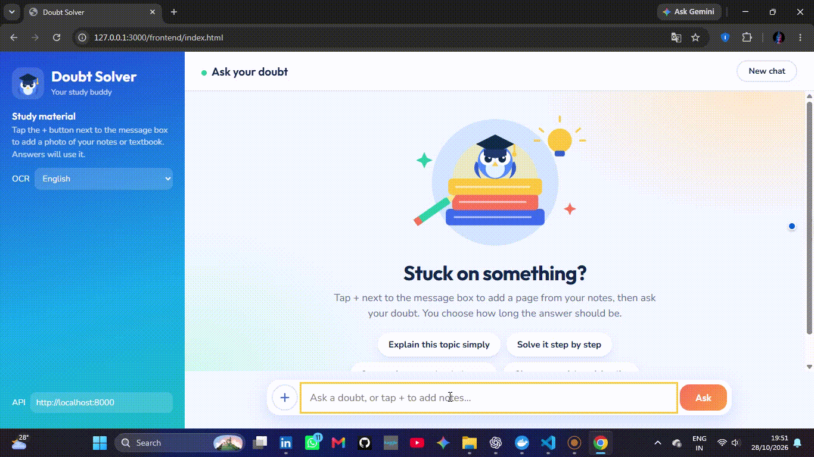
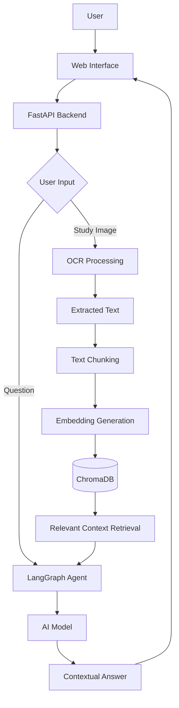

# 🧠 Doubt Solver Agent — AI-Powered Learning Assistant

<p align="center">
  <strong>Ask Questions. Upload Notes. Understand Better.</strong>
</p>

<p align="center">
  An AI-powered doubt-solving assistant that helps learners understand study material using Retrieval-Augmented Generation (RAG), OCR, and intelligent AI agents.
</p>

<p align="center">
  
  
  
  
  
</p>

---

## 🚀 Overview

**Doubt Solver Agent** is an AI-powered learning assistant designed to help students solve doubts and understand their study materials more effectively.

Instead of relying only on general AI knowledge, the system can extract text from uploaded study material, process it into searchable chunks, retrieve relevant information, and use an AI agent to generate contextual answers.

The project combines AI agents, document processing, semantic search, and a web API into a practical learning application.

### ✨ Key Features

- 🤖 **AI-Powered Doubt Solving** — Get answers to your questions using an AI agent.
- 📄 **Image-Based Learning** — Extract text from study material images using OCR.
- 🔎 **Retrieval-Augmented Generation (RAG)** — Retrieve relevant content before generating answers.
- 🧩 **Text Chunking** — Split extracted content into manageable chunks for retrieval.
- 🧠 **Semantic Embeddings** — Convert text into vector representations for similarity search.
- 🗃️ **Vector Database** — Store and retrieve relevant text using ChromaDB.
- 🔄 **LangGraph Workflow** — Build structured AI-agent workflows.
- ⚡ **FastAPI Backend** — Expose application functionality through API endpoints.
- 🐳 **Docker Support** — Containerize the application for consistent deployment.
- 🌐 **Web Interface** — Interact with the application through a frontend built with HTML.

<h2 align="center">🎬 Doubt Solver Agent — Live Demo</h2>
<h3>Live URL:<h3>

**https://quicksolve-1g1f.onrender.com**

<p align="center">
  
</p>

## 🏗️ Architecture



## 🛠️ Tech Stack

| Technology | Purpose |
|---|---|
| Python | Core application logic |
| FastAPI | REST API backend |
| LangGraph | AI-agent workflows |
| LangChain | LLM and embedding integrations |
| RAG | Context-aware question answering |
| OCR / Tesseract | Text extraction from images |
| ChromaDB | Vector storage and similarity search |
| Embeddings | Semantic representation of text |
| HTML | Frontend interface |
| Docker & Docker Compose | Containerization and deployment |

*Note: The exact model and embedding provider depend on your environment configuration.*

## 📁 Project Structure

```text
Doubt Solver Bot/
│
├── backend/
│   └── app/
│       ├── Database/
│       ├── rag/
│       │   ├── embeddings.py
│       │   ├── ocr.py
│       │   ├── retriever.py
│       │   ├── text_splitter.py
│       │   ├── vector_store.py
│       │   └── test.py
│       ├── graph.py
│       └── main.py
│
├── data/
├── uploads/
├── frontend/
│   └── index.html
│
├── .dockerignore
├── .env.example
├── .gitignore
├── docker-compose.yml
├── Dockerfile
├── requirements.txt
└── README.md
```

## ⚙️ Getting Started

### 1. Clone the Repository

```bash
git clone https://github.com/YOUR_USERNAME/doubt-solver-agent.git
cd doubt-solver-agent/backend
```

Replace `YOUR_USERNAME` with your GitHub username and adjust the repository URL to match your actual repository.

### 2. Create a Virtual Environment

Python 3.11 is recommended.

**Windows PowerShell:**

```powershell
py -3.11 -m venv .venv
.venv\Scripts\Activate.ps1
```

### 3. Install Dependencies

```bash
python -m pip install --upgrade pip
pip install -r requirements.txt
```

### 4. Configure Environment Variables

Create a `.env` file in the project root directory.

Add the environment variables required by your configured AI model, embedding provider, and other services.

Example:

```env
# Add your actual provider configuration
# AI_PROVIDER_API_KEY=your_api_key_here
```

Use the exact variable names expected by your application code. Never commit real API keys, passwords, or other secrets to GitHub.

### 5. Run the FastAPI Backend

From the project root, run:

```bash
python -m uvicorn backend.app.main:app --reload
```

If your Python package structure or import paths differ, use the corresponding application module path.

Open the API documentation:

**http://127.0.0.1:8000/docs**

## 🐳 Run with Docker

Make sure Docker Desktop is installed and running.

Build and start the application:

```bash
cd backend

docker compose up --build -d
```

View container logs:

```bash
docker compose logs -f
```

Stop the application:

```bash
docker compose down
```

Docker Compose configuration should include the required environment variables, persistent storage for uploaded files and the vector database, and the appropriate application port.

## 🔄 How It Works

1. **User Input:** The user asks a question or supplies a study-material image.
2. **OCR Processing:** Text is extracted from the image when applicable.
3. **Text Processing:** Extracted text is divided into smaller chunks.
4. **Embedding Generation:** Chunks are converted into vector embeddings.
5. **Vector Storage:** Embeddings and their associated text are stored in ChromaDB.
6. **Context Retrieval:** Relevant chunks are retrieved for the user's question.
7. **AI Agent:** The LangGraph workflow uses the question and available context to generate an answer.
8. **Response:** The answer is returned to the user through the application interface.

## 🎯 Use Cases

- 📚 Understanding textbook content
- 📝 Solving doubts from personal notes
- 🖼️ Asking questions about text contained in study images
- 🔍 Searching relevant information in learning material
- 🎓 Building AI-assisted educational applications

## 🔮 Future Improvements

- Support for PDF and multiple document formats
- Conversation history and persistent chat memory
- Multilingual question answering
- Streaming responses for faster interaction
- Source references for retrieved answers
- Improved OCR for handwritten notes
- User authentication and personal document collections
- Cloud deployment and scalable document processing

## 🔐 Security

- Keep API keys and credentials in environment variables.
- Exclude `.env`, uploaded private documents, and unnecessary local data from Git.
- Validate uploaded files and enforce appropriate file-size limits.
- Configure persistent storage and access controls before production deployment.

## 👨‍💻 Author

**Manish Raikwar**

Machine Learning Engineer | AI Agents | RAG | NLP | Python | FastAPI

- GitHub: [Your GitHub Profile](https://github.com/ManishRaikwar320)
- LinkedIn: [Your LinkedIn Profile](www.linkedin.com/in/manish-raikwar-209878264)

Replace the profile links with your actual URLs.

## 📌 Project Status

🚧 **Active Development**

This project is being developed to explore practical applications of AI agents, retrieval-augmented generation, OCR, and vector databases in education.

## ⭐ Support

If you find this project interesting, consider giving it a ⭐ on GitHub!

**Learn smarter. Solve doubts faster. Build with AI.**
